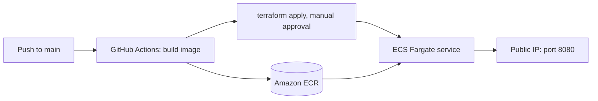

# Containerized App on ECS Fargate with Terraform

A small Flask API packaged as a Docker image and deployed to AWS ECS Fargate, with all AWS resources defined in Terraform and the build and deploy done by GitHub Actions. AWS access uses short-lived OIDC credentials, so no access keys are stored in GitHub.

> **Status: complete.** The pipeline deployed the app to Fargate successfully. The stack was then destroyed to avoid charges, so there is no live URL. To redeploy, push a change to `main` and approve the deployment.

## Architecture



1. **Build:** GitHub Actions builds the Docker image and tags it with the first 7 characters of the commit SHA.
2. **Push:** the image is pushed to a private Amazon ECR repository. Tags are immutable, and the push is skipped if the tag already exists.
3. **Deploy:** Terraform updates the ECS task definition to the new image tag, after a manual approval on the `production` environment.
4. **Run:** ECS runs the container on Fargate in the default VPC, with a public IP and a security group that opens only port 8080. There is no load balancer or NAT gateway, which keeps the cost of a demo low.

## Repository layout

| Path | Purpose |
|------|---------|
| `app/` | Flask app, `requirements.txt`, and `Dockerfile` |
| `bootstrap/` | One-time setup, run locally: the IAM role GitHub Actions assumes through OIDC |
| `infra/` | Terraform for ECR, ECS cluster, task definition, service, logs, and security group |
| `.github/workflows/` | `deploy.yml` (build, push, deploy after approval) and `terraform-plan.yml` (pull requests) |

## The app

A minimal Flask API served by gunicorn:

| Endpoint | Response |
|----------|----------|
| `GET /` | `{"message": "Hello from ECS Fargate", "version": "<image tag>"}` |
| `GET /health` | `{"status": "ok"}` |

The container runs as a non-root user and listens on port 8080.

Run it locally:

```
docker build -t ecs-demo ./app
docker run -d --rm -p 8080:8080 --name ecs-demo ecs-demo
curl -s localhost:8080/health
curl -s localhost:8080/
docker stop ecs-demo
```

## Security design

- **No stored AWS keys.** GitHub authenticates to AWS with OIDC and receives temporary credentials.
- **Scoped trust.** The IAM role can only be assumed by this repository, from a pull request or the `production` environment.
- **Least privilege where AWS allows it.** ECR, IAM, log, and state access are limited to this project's resources. ECS and EC2 actions cover all resources, because those services can't be scoped as tightly.
- **Image scanning on push** is enabled on the ECR repository, and the container runs as a non-root user.
- **Manual approval** before anything is applied.

## Lessons learned

- **GitHub's OIDC `sub` claim includes numeric owner and repository IDs.** A trust policy written in the plain `repo:owner/name` form was rejected with "Not authorized to perform sts:AssumeRoleWithWebIdentity". CloudTrail showed the exact subject GitHub sent, which made the fix a one-line change.
- **An account can have only one GitHub OIDC provider.** The bootstrap looks up the existing provider instead of creating a second one.
- **ECS needs a service-linked role** on first use in an account, so the pipeline role is allowed to create it.

## Redeploy and tear down

Redeploy by pushing a change under `app/`, `infra/`, or `.github/workflows/` to `main`, then approving the `production` deployment. The job summary prints the app's public URL.

Tear down from the `infra/` folder, which has access to the remote state:

```
terraform destroy
```

## Checklist

- [x] Flask app with a health endpoint
- [x] Dockerfile (slim image, non-root user, gunicorn)
- [x] OIDC role for this repository
- [x] Terraform for ECR and ECS Fargate
- [x] GitHub Actions workflow: build, push, and deploy
- [x] Deployed through the pipeline, then destroyed
- [ ] Capture a screenshot of the endpoint response (the stack was destroyed before this)

## Next steps

- Scan the image for vulnerabilities in the pipeline, for example with Trivy.
- Add an Application Load Balancer and a custom domain.
- Pin third-party actions to commit SHAs.
