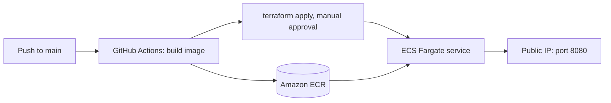

# Containerized App on ECS Fargate with Terraform

A small Flask API packaged as a Docker image and deployed to AWS ECS Fargate, with all AWS resources defined in Terraform and the build and deploy done by GitHub Actions. AWS access uses short-lived OIDC credentials, so no access keys are stored in GitHub.

> **Status: in progress.** The app and Dockerfile are done. The AWS infrastructure and the deployment workflow are being built. See the checklist below.

## Architecture (planned)



1. **Build:** GitHub Actions builds the Docker image and tags it with the commit SHA.
2. **Push:** the image is pushed to a private Amazon ECR repository.
3. **Deploy:** Terraform updates the ECS task definition to the new image tag, after a manual approval on the `production` environment.
4. **Run:** ECS runs the container on Fargate in the default VPC, with a public IP and a security group that opens only port 8080. There is no load balancer or NAT gateway, which keeps the cost of a demo low.

## Repository layout

| Path | Purpose | Status |
|------|---------|--------|
| `app/` | Flask app, `requirements.txt`, and `Dockerfile` | Done |
| `bootstrap/` | One-time setup, run locally: the IAM role GitHub Actions assumes through OIDC | In progress |
| `infra/` | Terraform for ECR, ECS cluster, task definition, service, logs, and security group | Planned |
| `.github/workflows/` | Build, push, and deploy workflow | Planned |

## The app

A minimal Flask API served by gunicorn:

| Endpoint | Response |
|----------|----------|
| `GET /` | `{"message": "Hello from ECS Fargate", "version": "<APP_VERSION or dev>"}` |
| `GET /health` | `{"status": "ok"}` (used for health checks) |

The container runs as a non-root user and listens on port 8080.

## Run it locally

```
docker build -t ecs-demo ./app
docker run -d --rm -p 8080:8080 --name ecs-demo ecs-demo
curl -s localhost:8080/health
curl -s localhost:8080/
docker stop ecs-demo
```

## Security design

- **No stored AWS keys.** GitHub authenticates to AWS with OIDC and receives temporary credentials.
- **Scoped trust.** The IAM role can only be assumed by this repository, from a pull request or the `production` environment. GitHub's OIDC subject includes numeric owner and repository IDs, so the trust policy uses that exact format.
- **Least privilege where AWS allows it.** ECR, IAM, log, and state access are limited to this project's resources. ECS and EC2 actions cover all resources, because those services can't be scoped as tightly.
- **Non-root container** and a private ECR repository.
- **Manual approval** before anything is applied.

## Status

- [x] Flask app with a health endpoint
- [x] Dockerfile (slim image, non-root user, gunicorn)
- [ ] OIDC role for this repository (`bootstrap/`)
- [ ] Terraform for ECR and ECS Fargate (`infra/`)
- [ ] GitHub Actions workflow: build, push, and deploy
- [ ] Deploy, verify the public endpoint, then `terraform destroy`

## Cost note

Fargate bills while a task is running. This project has no load balancer or NAT gateway, and the demo is meant to be destroyed after testing.

## Next steps

- Scan the image for vulnerabilities in the pipeline.
- Add a plan step on pull requests.
- Pin third-party actions to commit SHAs.
